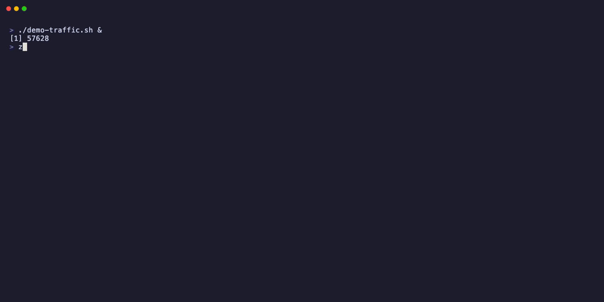

# zlodev

[](https://github.com/vandot/zlodev/actions/workflows/ci.yml) [](LICENSE) [](https://github.com/vandot/zlodev/releases) 

Local reverse proxy with TLS termination, custom DNS, and a terminal UI.

zlodev sits between your browser and your local dev server, providing HTTPS with a real certificate, a custom domain (`https://dev.lo`), and a TUI for inspecting, intercepting, and replaying HTTP traffic.

<p align="center">
  
</p>

## Features

- **HTTPS reverse proxy** — TLS termination with auto-generated CA and domain certificates
- **Multi-app routing** — route by subdomain (`api.dev.lo`) or path prefix (`/api`) to local ports or external hosts
- **Custom DNS** — resolves `*.lo` to localhost, no `/etc/hosts` editing
- **Terminal UI** — live request list with method, path, status, timing, and body size
- **Dev server launcher** — run your dev server alongside zlodev and monitor its output in a split-pane TUI
- **Request/response interception** — hold, inspect, edit, accept, or drop requests and responses with optional pattern matching
- **Request replay** — re-send any completed request
- **Copy as curl** — copy any request as a `curl` command
- **HAR export** — export captured traffic as HTTP Archive files, with cookies and auth headers redacted by default
- **Request starring** — star important requests so they survive ring buffer overflow
- **Search/filter** — filter requests by path, method, or status code
- **WebSocket passthrough** — `wss://dev.lo` upgrades are proxied to your dev server, so HMR and live reload work over HTTPS (see [WebSockets](#websockets))
- **Cross-platform** — macOS, Linux, and Windows

## Install

### Homebrew (macOS, Linux)

```sh
brew install vandot/tap/zlodev
```

On Linux, run the `setcap` command Homebrew prints after install, so zlodev can bind ports 53, 80 and 443 without root.

### Scoop (Windows)

```powershell
scoop bucket add vandot https://github.com/vandot/scoop-bucket
scoop install zlodev
```

### Linux packages

Each release has `.deb`, `.rpm` and Arch (`.pkg.tar.zst`) packages for amd64 and arm64. They install `/usr/bin/zlodev` and run `setcap` for you:

```sh
sudo apt install ./zlodev_0.7.0_amd64.deb      # Debian, Ubuntu
sudo dnf install ./zlodev-0.7.0-1.x86_64.rpm   # Fedora, RHEL
sudo pacman -U zlodev-0.7.0-1-x86_64.pkg.tar.zst  # Arch
```

### Install script

Pre-built binaries have no external dependencies — single binary, nothing to install.

```sh
curl -fsSL https://raw.githubusercontent.com/vandot/zlodev/main/install.sh | sh
```

The script checks the download against the release's `SHA256SUMS`. Release archives and packages also carry a signed [build provenance attestation](https://docs.github.com/en/actions/security-for-github-actions/using-artifact-attestations), which you can check with the GitHub CLI after downloading an archive by hand:

```sh
gh attestation verify zlodev-linux-amd64.tar.gz --repo vandot/zlodev
```

Checksums and attestations are published for releases after v0.5.1.

### Build from source

Building from source requires [Zig](https://ziglang.org/download/) 0.17.0. No other dependencies — BoringSSL is compiled from source automatically.

```sh
git clone https://github.com/vandot/zlodev.git
cd zlodev
zig build -Doptimize=ReleaseSafe
```

The binary is at `zig-out/bin/zlodev`.

On Linux, grant the binary permission to bind to privileged ports (53, 80, 443) without root:

```sh
sudo setcap cap_net_bind_service=+eip zig-out/bin/zlodev
```

#### Build options

| Option | Description | Default |
|--------|-------------|---------|
| `-Dversion=STRING` | Version string | `dev` |
| `-Dmax-entries=N` | Max request entries in ring buffer | `500` |
| `-Dstrip=BOOL` | Strip debug info from the binary | `true` unless Debug build |

## Quick start

### macOS / Linux

**Option 1: zlodev launches your dev server**

```sh
# 1. Install certificates and DNS resolver (one-time setup, requires sudo)
zlodev install

# 2. Start zlodev with your dev server integrated
zlodev start --command="npm run dev"
```

Your app is now available at `https://dev.lo`. The TUI shows live traffic and your dev server logs side-by-side.

**Option 2: Launch dev server separately (original workflow)**

```sh
# 1. Install certificates and DNS resolver (one-time setup, requires sudo)
zlodev install

# 2. Start your dev server (e.g. on port 3000)
npm run dev &

# 3. Start zlodev
zlodev start
```

Your app is now available at `https://dev.lo`. The TUI shows live traffic.

### Windows

Run all commands in an **elevated terminal** (Run as Administrator).

```powershell
# 1. Install certificates and DNS resolver
zlodev install

# 2. Start your dev server, then start zlodev
zlodev start
```

> **Note:** Disable "Use secure DNS" in your browser (Edge: Settings → Privacy → Security → toggle off "Use secure DNS") for DNS resolution to work.

## Usage

### Commands

```
zlodev install              install certificates and DNS
zlodev install --cert       install certificates only
zlodev install --dns        install DNS only
zlodev uninstall            uninstall certificates and DNS
zlodev uninstall --cert     uninstall certificates only
zlodev uninstall --dns      uninstall DNS only
zlodev start                start proxy + DNS + TUI
zlodev start --dns          start DNS server only (log mode)
```

### Options

```
-p=PORT, --port=PORT       target port [auto-detect or 3000]
-b=ADDR, --bind=ADDR       listen address [default 0.0.0.0, local clients only]
--route=PATTERN=TARGET     route by subdomain or path (repeatable)
--command=CMD              dev server command to launch and monitor
-c=PATH, --config=PATH     config file path [default .zlodev]
--max-body=SIZE            max request body size [default 10M]
--timeout=SECONDS          upstream connect/response timeout [default 30, 0 = none]
--no-tui                   disable TUI, log to stderr
--insecure-upstream        don't verify external route certificates
-l, --local                use .local domain (mDNS)
--dns                      DNS only (install/uninstall/start)
--cert                     certificates only (install/uninstall)
-f, --force                force reinstall
-v, --version              show version
-h, --help                 show help
```

Value options also accept a space: `--port 3000`.

`SIZE` accepts suffixes: `K` (KB), `M` (MB), `G` (GB). Example: `--max-body=50M`

Request bodies up to `--max-body` are forwarded in full (larger ones get `413`); the TUI keeps the first 32 KB of each body for display.

`--timeout` limits how long zlodev waits to connect to the dev server and for its response to start; past that the browser gets `504`. Once a response has started there is no timeout, so server-sent events, long polls and slow downloads run until either side closes.

By default zlodev listens on `0.0.0.0` (on macOS that is what lets it use ports 80 and 443 without sudo) but only answers connections from your own machine. Other devices on your network are refused. To let them in, use `-l` (see [Local network](#local-network-mdns)) or set the address explicitly, for example `-b=0.0.0.0`.

### Config file

Place a `.zlodev` file in your project directory instead of repeating CLI flags:

```
port=3000
route=api=3001
route=/webhooks=8080
command=npm run dev
intercept=POST /api
no-tui
```

zlodev reads `.zlodev` from the current directory on `start`. Use `-c=PATH` to specify a different location. CLI arguments override config file values.

Supported options: `port`, `p`, `bind`, `b`, `route`, `max-body`, `timeout`, `command`, `intercept`, `no-tui`, `local`, `l`, `dns`.

### Routing

Route requests to different backend ports by subdomain or path prefix:

```sh
# Subdomain routing — no "/" prefix
zlodev start --route=api=3001 --route=dashboard=4200

# api.dev.lo      → 127.0.0.1:3001
# dashboard.dev.lo → 127.0.0.1:4200
# dev.lo          → 127.0.0.1:3000 (default)

# Path routing — "/" prefix
zlodev start --route=/api=3001 --route=/admin=8080

# dev.lo/api/*    → 127.0.0.1:3001
# dev.lo/admin/*  → 127.0.0.1:8080
# dev.lo/*        → 127.0.0.1:3000 (default)

# Mix both
zlodev start --route=api=3001 --route=/webhooks=8080

# External upstream — route to remote services
zlodev start --route=api=staging.api.example.com
zlodev start --route=/payments=payments.stripe.com:443

# api.dev.lo → staging.api.example.com:443 (TLS)
# dev.lo/payments/* → payments.stripe.com:443 (TLS)
```

Priority: subdomain match > longest path prefix > default port.

External routes connect via TLS, rewrite the `Host` header to the upstream hostname, and rewrite `Set-Cookie` domain attributes to `dev.lo` so cookies work correctly in the browser. If no port is specified, defaults to 443.

The upstream's certificate is verified against your system's trusted roots and must match the route's hostname; otherwise the request gets a 502 that says so. On macOS and Linux the roots come from the system PEM bundle (`/etc/ssl/cert.pem`, `/etc/ssl/certs/ca-certificates.crt`, …), on Windows from the system root store; set `SSL_CERT_FILE` to use your own bundle. For a staging server with a self-signed certificate, pass `--insecure-upstream` (or `insecure-upstream` in `.zlodev`) to skip verification.

> **Note:** Subdomain routes are not supported in local mode (`-l`), since mDNS does not support arbitrary subdomains.

### WebSockets

WebSocket connections work through zlodev without any setup. The page at `https://dev.lo` opens `wss://dev.lo/...`. zlodev terminates TLS and forwards the upgrade request to your dev server as plain `ws://`, adding the same forwarding headers as normal requests. After the `101 Switching Protocols` reply, it relays frames in both directions. This is what keeps HMR and live reload (Vite, webpack-dev-server, Next.js, etc.) working over HTTPS.

- Upgrades follow the same routing as other requests: the default port, subdomain routes (`wss://api.dev.lo`) and path routes (`wss://dev.lo/socket` with `--route=/socket=4000`).
- External routes work too (`--route=ws=echo.websocket.org` → `wss://ws.dev.lo`). zlodev connects to the upstream over TLS, verifying its certificate like any external request. It rewrites `Host` to the upstream and keeps the original as `X-Forwarded-Host`. `Origin` is forwarded unchanged as `https://dev.lo`, so an upstream that checks `Origin` has to allow it.
- The TUI lists each upgrade as a request with status `101` and its request and response headers. The entry is kept while the socket is open. Sockets stay open until the browser or the dev server closes them, however long they sit idle. Individual frames are not captured or shown.
- Interception doesn't apply to WebSocket traffic, and frames can't be edited or replayed.

### Dev server integration

Launch your dev server alongside zlodev and monitor its output in the TUI:

```sh
# CLI
zlodev start --command="npm run dev"

# Or in .zlodev config
command=npm run dev
```

The dev server starts when zlodev boots and appears in a split-pane below the request list. You can toggle the logs pane with `l`, switch focus between requests and logs with `Tab`, and restart the server with `R` (when focused on logs).

Logs pane controls:
- `l` — toggle logs pane visibility
- `Tab` — switch focus between requests and logs
- `j` / `k` — scroll focused pane
- `g` / `G` — jump to top / bottom of focused pane
- `s` — toggle autoscroll for focused pane
- `R` — restart dev server (when focused on logs) or replay request (when focused on requests)

### Port auto-detection

If `--port` is not specified, zlodev detects the port from:

1. `PORT=` in `.env` file
2. Framework config files (e.g. `next.config.js` → 3000, `vite.config.ts` → 5173)
3. Falls back to 3000

### Local network (mDNS)

```sh
# Use .local domain for access from mobile devices on the same network
zlodev install -l
zlodev start -l
# -> https://yourhostname.local
```

### Headless mode

```sh
# Run without TUI, logs to stderr (useful for scripts/CI)
zlodev start --no-tui
```

zlodev answers `/.zlodev/health` itself on ports 443 and 80 with `ok`, which is handy for waiting until it is up. Every other path, including `/health`, goes to your dev server.

```sh
until curl -sf https://dev.lo/.zlodev/health; do sleep 0.2; done
```

### Intercept

Press `i` in the TUI to enable intercept mode. You'll be prompted for a pattern — matching requests are held for inspection while all others pass through normally.

- **Empty pattern** — intercepts all requests and responses
- **Path pattern** — `intercept=/api` matches any request with `/api` in the path
- **Method pattern** — `intercept=POST` matches all POST requests (a method word matches only the method: `POST` doesn't hold `GET /posts`)
- **Combined** — `intercept=POST /api` matches POST requests to `/api`
- **Request only** — `intercept=req:/api` holds only requests (responses pass through)
- **Response only** — `intercept=resp:/api` holds only responses (requests pass through)

Without a `req:` or `resp:` prefix, both requests and responses are intercepted.

When a response is intercepted, the TUI shows two entries: the original request with its upstream round-trip time, and a `↳` response entry showing `RESP` in the status column with a live hold timer. Press `e` on the response entry to edit status code, headers, and body before it reaches the browser. Press `a` to accept or `d` to drop.

Response entries cannot be replayed (`r`/`R`) — replay the original request above it instead, which will naturally produce a new response.

Requests and responses too large to edit (URL over 512 bytes, headers over 2 KB, or body over 32 KB) pass through without being held and show `BIG` in the status column. They still reach the server and browser in full: the TUI shows the first 32 KB, marked `... truncated in view`. Replay and copy-as-curl are refused for requests whose captured copy is truncated.

Requests zlodev answers itself (dev server down, timeout, body over `--max-body`, head too large, bad chunked encoding) also appear in the list, with a `!` after the status (`502!`, `504!`). The detail view starts with the reason, for example `zlodev: connection refused 127.0.0.1:3000`; the browser gets the same text as the response body.

Pattern matching is case-insensitive. Press `i` again to disable intercept and release all held requests.

You can also set a default intercept pattern in your `.zlodev` config file:

```
intercept=resp:POST /api
```

## TUI keybindings

### List view (requests pane)

| Key | Action |
|-----|--------|
| `j` / `k` (or `↓` / `↑`) | Move down / up |
| `G` | Go to end |
| `g` | Go to top |
| `s` | Toggle autoscroll |
| `l` | Toggle logs pane (if dev server configured) |
| `Tab` | Switch focus between requests and logs |
| `Enter` | Open detail view |
| `/` | Search / filter by path, method, or status |
| `Esc` | Clear filter |
| `*` | Star / unstar request (survives buffer overflow) |
| `i` | Intercept (prompts for pattern / toggles off) |
| `a` | Accept held request |
| `A` | Accept all held requests |
| `d` | Drop held request / delete completed request |
| `c` | Copy request as curl command |
| `e` | Edit request / response |
| `r` | Edit & replay request |
| `R` | Quick replay (no edit) or restart dev server (when focused on logs) |
| `E` | Export traffic as HAR file (cookie and auth values redacted) |
| `Ctrl+E` | Export HAR with all headers |
| `C` | Clear all requests |
| `?` | Toggle help overlay (`Esc` also closes it) |
| `q` | Quit |

### Logs pane (when dev server is running)

| Key | Action |
|-----|--------|
| `j` / `k` (or `↓` / `↑`) | Scroll down / up |
| `G` | Go to end |
| `g` | Go to top |
| `s` | Toggle autoscroll |
| `R` | Restart dev server |
| `Tab` | Switch focus to requests |

### Detail view

| Key | Action |
|-----|--------|
| `j` / `k` (or `↓` / `↑`) | Scroll down / up |
| `G` / `g` | Scroll to bottom / top |
| `n` / `p` (or `→` / `←`) | Next / previous request |
| `b` | Toggle body display |
| `a` | Accept held request |
| `d` | Drop held request / delete completed request |
| `*` | Star / unstar request |
| `c` | Copy request as curl command |
| `e` | Edit request / response |
| `r` | Edit & replay request |
| `R` | Quick replay (no edit) |
| `i` | Intercept (prompts for pattern / toggles off) |
| `s` | Toggle autoscroll |
| `q` / `Esc` | Back to list |

### Edit view

| Key | Action |
|-----|--------|
| `Tab` / `Shift+Tab` | Next / previous field |
| `←` / `→`, `Home` / `End` | Move cursor |
| `↑` / `↓` | Move between lines (multiline fields) |
| `Enter` | New line (multiline fields) or next field |
| `Ctrl+S` | Save — accept held entry with edits, or replay edited request |
| `Esc` | Cancel |

## How it works

1. **DNS** — A lightweight DNS server resolves `*.lo` queries to `127.0.0.1`. On macOS it registers via `/etc/resolver/`, on Linux via `systemd-resolved`, on Windows via NRPT rules. On Linux zlodev adds a dummy interface `zlodev0` (`192.0.0.8`) that sends `*.lo` lookups to its DNS server on `192.0.0.8:53`; other lookups are untouched. The interface is created by `systemd-networkd` when it is running, otherwise by NetworkManager (a connection named `zlodev`), so Linux needs systemd and systemd-resolved plus one of the two.

2. **Certificates** — On `install`, zlodev generates a local CA and domain certificate, then adds the CA to your system trust store. The CA is unique to your machine. On Linux, browsers don't read the system bundle, so `install` also adds the CA to the NSS databases of Chromium-based browsers (Chrome, Chromium, Brave, Edge, Vivaldi, Opera, including snap installs) and Firefox (every profile in `~/.mozilla/firefox`, `~/.config/mozilla/firefox` and the snap install). This needs `certutil`: `libnss3-tools` on Debian/Ubuntu, `nss-tools` on Fedora, `nss` on Arch. Without it, `install` still succeeds and prints a warning. Restart Firefox if it was running. `install` and `install -l` keep separate trust entries, so either can be uninstalled without affecting the other. Private keys are written readable only by you (`0600`, in a `0700` directory). On every `start`, zlodev re-signs the domain certificate with the local CA when it has fewer than 30 days left. This needs no sudo, since the CA in your trust store doesn't change. CAs created by `install` are limited to your zlodev domain (`dev.lo`, or `<host>.local` with `-l`) by an X.509 name constraint, so the CA can't vouch for any other site. Installs from older versions can get the constraint with `zlodev install -f`.

3. **Proxy** — An HTTPS reverse proxy accepts connections on port 443, terminates TLS, and forwards plain HTTP to your dev server. Responses are relayed back over TLS. A client that doesn't finish the TLS handshake within 10 seconds is dropped. zlodev replaces the browser's `Accept-Encoding` with `Accept-Encoding: identity`, so responses arrive uncompressed and the TUI shows readable bodies (the browser doesn't notice). Each request carries `X-Forwarded-Host`, `X-Forwarded-For`, `X-Forwarded-Proto: https` and `X-Real-IP`.

4. **HTTP server** — A plain HTTP server on port 80 serves the CA certificate download page (for mobile devices) and redirects other requests to HTTPS, keeping the `dev.lo` subdomain.

5. **Dev server integration** — When `--command` is provided, zlodev spawns a shell process running your dev server command. stdout and stderr are captured into a bounded ring buffer and displayed in a split-pane logs view. Its stdin is `/dev/null`, since the TUI owns the terminal. The dev server restarts when you press `R` in the logs pane, or shuts down cleanly when you quit zlodev.

## Troubleshooting

### Port 443 already in use

Another process is using port 443. Check with:
```sh
# macOS
sudo lsof -i :443
# Linux
sudo ss -tlnp | grep :443
# Windows (elevated terminal)
netstat -an | findstr ":443"
```

### Permission denied on ports 53/80/443 (Linux)

On Linux, binding to ports below 1024 requires elevated privileges. Instead of running as root, zlodev uses Linux file capabilities. The install script sets this automatically, but if you built from source:

```sh
sudo setcap cap_net_bind_service=+eip $(which zlodev)
```

This grants only the specific capability to bind privileged ports — no other root access.

### Certificate not trusted

Re-run the install with force:
```sh
zlodev install -f
```

On Linux, if curl works but the browser warns, check that `certutil` is installed (see above), then run `zlodev install -f`. On macOS and Windows, Firefox older than 120 needs `security.enterprise_roots.enabled` set to `true` in `about:config`.

### DNS not resolving

Check if the DNS resolver is installed:
```sh
# macOS
cat /etc/resolver/lo
# Linux
resolvectl query dev.lo
# Windows (elevated PowerShell)
Resolve-DnsName dev.lo
```

If missing, reinstall DNS:
```sh
zlodev install --dns
```

On Linux, `install` stops with an error unless systemd is PID 1, `systemd-resolved` is active and either `systemd-networkd` or NetworkManager is running. With networkd, it fails if `systemd-networkd` can't be reloaded (for example when it is masked). zlodev reloads networkd with `networkctl reload` rather than restarting it, so your other network interfaces are left alone. If the reload failed, run `zlodev uninstall --dns` to remove the half-written `zlodev0` interface files before trying again.

Upgrading from 0.6.0 or earlier on Linux: zlodev's DNS moved from port 5354 to 53, so run `zlodev install --dns` once. Until you do, `start` prints a warning and `.lo` names don't resolve.

On Windows, make sure "Use secure DNS" is disabled in your browser — Chromium browsers bypass the system DNS resolver when this is enabled.

### Logs

With the TUI on, errors go to `zlodev.log` in the zlodev data folder (`~/.local/share/zlodev` or `$XDG_DATA_HOME/zlodev` on Linux, `~/Library/Application Support/zlodev` on macOS, `%LocalAppData%\zlodev` on Windows). Over 1 MB it is moved to `zlodev.log.1` at start. Older versions wrote to `~/.zlodev/zlodev.log`; that file can be deleted.

### Vite: "Blocked request. This host is not allowed"

Vite 5.1+ checks the `Host` header. Add the zlodev domain to `vite.config`: `server: { allowedHosts: ['dev.lo', '.dev.lo'] }` (with `-l`, add your `<host>.local`).

### Mobile device can't connect

1. Make sure the phone is on the same network
2. Start zlodev with `--local` flag: `zlodev start -l` (without `-l`, zlodev only answers your own machine)
3. Open `http://yourhostname.local/ca` on the phone to install the CA certificate
4. Follow the platform-specific instructions on the download page

## Uninstall

```sh
zlodev uninstall
```

This removes the CA from your system trust store, deletes generated certificates, and removes the DNS resolver configuration.

## License

MIT
